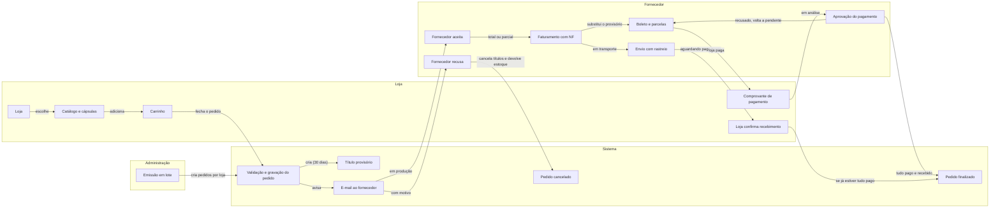

# 3. Jornada do pedido

O pedido nasce no carrinho da loja, passa pelo fornecedor para produção, faturamento e envio, e termina quando o último título é pago.

### Etapas, uma a uma

| Etapa | Quem age | O que acontece | Situação do pedido |
|---|---|---|---|
| 1. Escolher | Loja (ou vendedor por ela) | Navega no catálogo e nas cápsulas liberadas para o seu tipo de cliente | — |
| 2. Montar o carrinho | Loja | Junta produtos e cápsulas; o portal separa um pedido por fornecedor | — |
| 3. Fechar o pedido | Loja | Escolhe a loja de entrega e a forma de pagamento de cada fornecedor | — |
| 4. Validar e gravar | Sistema | Recalcula preços, confere mínimo, bloqueio, endereço e estoque, e grava tudo de uma vez | Novo pedido |
| 5. Avisar | Sistema | Manda e-mail de "novo pedido" ao fornecedor e cria um título provisório para 30 dias | Novo pedido |
| 6. Aceitar ou recusar | Fornecedor | Aceita (pode informar a data prevista) ou recusa com motivo | Em produção ou Cancelado |
| 7. Faturar | Fornecedor | Registra a NF, os itens faturados e as formas de pagamento | Parcialmente faturado ou Faturado |
| 8. Cobrar | Fornecedor | Envia boleto (parcelas da nota) ou dados de PIX; o título provisório dá lugar às parcelas | Faturado |
| 9. Enviar | Fornecedor | Informa transportadora e rastreio | Em transporte |
| 10. Receber | Loja | Confirma o recebimento | Aguardando pagamento ou Finalizado |
| 11. Pagar | Loja | Informa o pagamento e envia o comprovante de cada título | Título em análise |
| 12. Aprovar | Fornecedor ou admin | Aprova (título pago) ou recusa com motivo (volta a pendente) | Finalizado quando tudo está pago |

### Caminhos paralelos

1. **Cancelamento pela loja:** só enquanto o pedido é "novo pedido". Os títulos em aberto são cancelados e o estoque volta sozinho.
2. **Cancelamento pelo fornecedor ou pela administração:** os mesmos efeitos acontecem. Títulos já pagos não são cancelados.
3. **Pedido em lote:** a administração emite pedidos de uma cápsula para várias lojas. Só a administração cancela esses pedidos.
4. **Faturamento em partes:** o fornecedor pode faturar só parte dos itens. O pedido fica "parcialmente faturado" até o resto sair.
5. **Quebra de produção:** item que não será entregue é baixado como quebra, e o valor final do pedido diminui.
6. **Revisão de itens:** a equipe ou o fornecedor ajusta itens; a loja recebe e-mail e o estoque acompanha a diferença.

### E-mails automáticos

| Momento | Quem recebe |
|---|---|
| Novo pedido | Fornecedor |
| Pedido aceito (em produção) | Loja |
| Pedido faturado | Loja |
| Pedido em transporte | Loja |
| Pedido cancelado (com o motivo) | Loja |
| Boleto, NF ou dados de PIX disponíveis | Loja |
| Itens do pedido revisados | Loja |
| Comprovante enviado | Fornecedor |
| Comprovante recusado ou aprovado | Loja |
| Pagamento confirmado | Loja |

Cada e-mail sai uma vez só por pedido, evento e destinatário.

### Diagrama

### Perguntas em aberto

- Em que momento exato o pedido "aguardando pagamento" passa a "finalizado" quando o último título é aprovado depois do recebimento? O código confirmado cobre a passagem na confirmação de recebimento.

---

Fontes: código do `main`, estrutura do banco de produção Polowear2 (só leitura), PRs #1 a #34 e o diagnóstico de 23/11/2026. Índice: [docs/README.md](../README.md).
