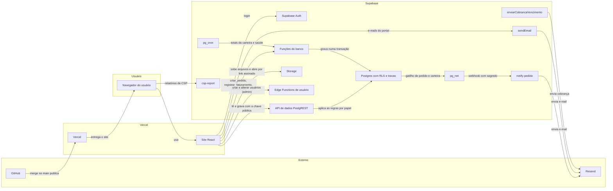

# 8. Arquitetura

O portal é um site React na Vercel que conversa direto com o Supabase. No Supabase ficam o banco, as regras de acesso, as funções, os arquivos e os e-mails.

Não existe servidor próprio entre o site e o banco. A segurança fica no banco: regras por linha, travas por coluna e funções que validam tudo.

### Componentes

| Componente | Tecnologia | Papel |
|---|---|---|
| Site (front-end) | Vite 6, React 18 em JavaScript, React Router 7, Tailwind e shadcn/ui | Telas do portal, uma página por rota, carregadas sob demanda |
| Hospedagem | Vercel | Publica o site a cada merge no main; cabeçalhos de segurança e cache |
| Banco de dados | Supabase Postgres 17 | Tabelas, visões, funções e gatilhos |
| API de dados | PostgREST do Supabase | O site lê e grava nas tabelas pela chave pública, com as regras de acesso |
| Login | Supabase Auth | E-mail e senha; sessão guardada no navegador |
| Regras de acesso | RLS (Row Level Security) | Cada papel só vê e altera as linhas que pode |
| Travas de coluna | Gatilhos de guarda | Impedem mudanças proibidas mesmo em linhas permitidas |
| Funções do banco | PL/pgSQL e SQL | Criar pedido, faturar, trocar parcelas, indicadores |
| Edge Functions | Deno, no Supabase | Criar usuário, trocar senha e e-mail, enviar e-mail, avisos de pedido, cobrança e coleta de CSP |
| Arquivos | Supabase Storage | Fotos (público), documentos (privado, link de 1 hora) e assets (público) |
| Tarefas agendadas | pg_cron | Totais da carteira, verificação de saúde e limpeza de relatórios |
| Chamadas HTTP do banco | pg_net | O gatilho de pedidos e carteira chama a função de e-mail |
| E-mail | Resend | Envio dos e-mails com o domínio info.portalpolowear.com.br |

### Endereços

| Endereço | O que é |
|---|---|
| www.portalpolowear.com.br | Produção |
| polo-wear-b2-b.vercel.app | Mesmo deploy de produção |
| polo-wear.vercel.app | App antigo; redireciona para o portal novo |
| Projeto Supabase Polowear2 (região sa-east-1) | Banco de produção, único |

### Edge Functions

| Função | Quem chama | O que faz | Proteção |
|---|---|---|---|
| create-user | Admin | Cria usuário no login e na tabela de usuários | Exige admin |
| update-user-email | Admin | Troca o e-mail de login | Exige admin |
| update-user-password | Admin | Troca a senha | Exige admin |
| resetUserPassword | Admin | Gera nova senha | Exige admin |
| deleteAuthUser | Admin | Apaga o login do usuário | Exige admin |
| sendEmail | Portal | Envia e-mails do portal e o aviso de lead do cadastro | Sem login só o modelo de lead, com limite por IP; com login, destinatário conforme o papel |
| notify-pedido | Gatilho do banco | E-mails de mudança de pedido e de título | Segredo do webhook; não repete e-mail |
| enviarCobrancaVencimento | Admin ou agendamento | E-mail de cobrança dos títulos que vencem no dia | Exige admin ou segredo de agendamento |
| csp-report | Navegador | Grava violações da política de conteúdo (CSP) | Pública, com limites de tamanho e de taxa |

Todas aceitam chamada só dos domínios do portal (CORS).

### Tarefas agendadas (pg_cron)

| Tarefa | Horário (Brasília) | O que faz |
|---|---|---|
| csp_reports_limpeza_30d | 00h17 | Apaga relatórios de CSP com mais de 30 dias |
| daily-health-check | 03h00 | Grava uma verificação de saúde e limpa as de mais de 7 dias |
| recalcular-totais-carteira | 03h10 | Recalcula total em aberto e vencido de todos os clientes |

### Como um pedido atravessa o sistema

1. O site chama a função criar_pedido com o carrinho.
2. A função valida, grava o pedido, baixa o estoque e cria o título provisório numa transação.
3. O gatilho de pedidos grava o histórico e chama a notify-pedido via pg_net.
4. A notify-pedido monta o e-mail e envia pelo Resend.
5. O fornecedor abre o documento por link assinado do Storage.

### Diagrama

### Perguntas em aberto

Ver o documento interno do dono.

---

Fontes: código do `main`, estrutura do banco de produção Polowear2 (só leitura), PRs #1 a #34 e o diagnóstico de 23/11/2026. Índice: [docs/README.md](../README.md).
