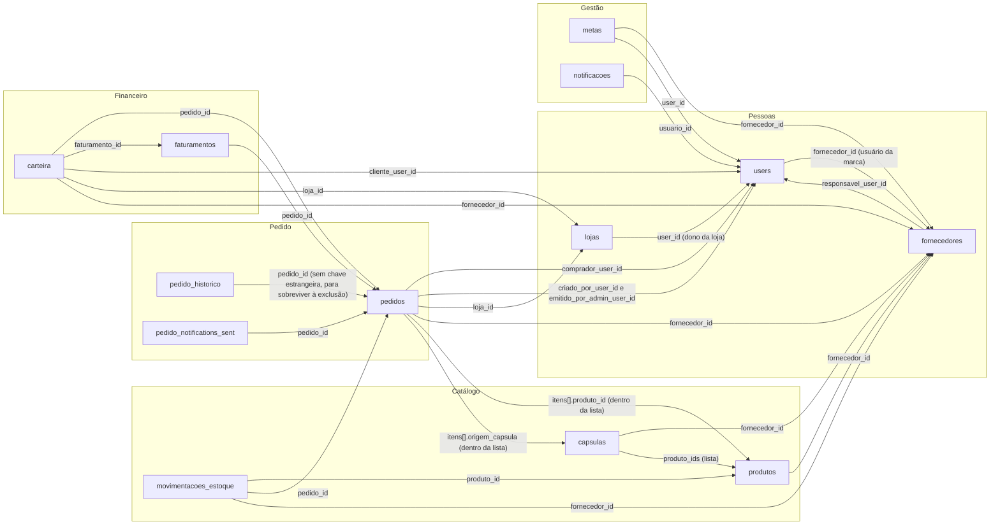

# 9. Modelo de dados

O centro do modelo é o pedido: ele liga comprador, loja e fornecedor, guarda os itens e recebe as notas fiscais e os títulos.

Quantidade de linhas por tabela: ver o documento interno do dono.

### Tabelas principais

| Tabela | O que guarda | Campos-chave |
|---|---|---|
| users | Usuários do portal, um por login | id (o mesmo do login), role, fornecedor_id, bloqueado, total_em_aberto, total_vencido |
| lojas | Unidades dos clientes | user_id (dono), endereço, cnpj, bloqueada, ativa |
| fornecedores | Marcas | pedido_minimo_multimarca, pedido_minimo_franqueado, metodos_pagamento_aceitos, boleto_faturado_prazos_dias, clientes_boleto_faturado |
| produtos | Catálogo | fornecedor_id, tipo_venda, preços por perfil, disponibilidade, controla_estoque, estoque, variantes_cor, data_prevista_entrega, ativo, arquivado |
| capsulas | Kits de coleção | fornecedor_id, produto_ids, produtos_quantidades, meses_disponiveis, disponivel_franqueado, disponivel_multimarca, grupo, ano |
| pedidos | Pedidos | comprador_user_id, loja_id, fornecedor_id, itens (lista), status, status_pagamento, valor_total, valor_final, valor_faturado, valor_quebra, meses_entrega_efetivos, meses_faturamento, idempotency_key |
| faturamentos | Notas fiscais | pedido_id, numero_nf, numero_nf_norm, data_emissao, itens, valor_total, pagamentos |
| carteira | Títulos a receber | pedido_id, faturamento_id, cliente_user_id, loja_id, fornecedor_id, parcela_numero, valor, data_vencimento, status, comprovante_url |
| movimentacoes_estoque | Entradas e saídas de estoque | produto_id, fornecedor_id, pedido_id, tipo, quantidades antes e depois, motivo |
| pedido_historico | Auditoria do pedido | pedido_id, autor, papel, status de e para, campos alterados |
| pedido_notifications_sent | E-mails já enviados por pedido | pedido_id, event_key, recipient |
| notificacoes | Avisos do sino | usuario_id, link |
| metas | Metas mensais | fornecedor_id ou user_id, ano, mes, valor_meta, pecas_meta |
| contacts | Contatos do CRM | — |
| csp_reports | Violações de CSP | directive, blocked_uri, document_uri |
| app_settings | Configurações internas (só admin) | key |

Tabelas menores: banners, recursos, whatsapp_templates, pending_users, franqueados, carrinho_itens e health_checks.

### Visões (consultas prontas)

| Visão | Para que serve |
|---|---|
| pedidos_resumo | Pedidos sem a lista de itens, para listas e o sino |
| carteira_com_pedido | Títulos com os dados do pedido e do cliente, para a Carteira |
| carteira_totais_cliente_fornecedor | Em aberto e vencido por cliente e fornecedor |
| vw_conferencia_cobranca | Nota a nota: faturado contra títulos |

Todas respeitam as regras de acesso de quem consulta.

### Como os itens ficam no pedido

Cada item da lista "itens" do pedido traz:

| Campo | Significado |
|---|---|
| produto_id, nome, referência | O produto |
| tipo_venda, total_pecas_grade | Grade ou unidade |
| quantidade, preco, total | Quantidade, preço unitário e total do item |
| cor_selecionada, tamanho_selecionado | A variação comprada |
| origem_capsula | A cápsula de onde o item veio |
| mes_entrega | O mês escolhido na cápsula |
| quantidades faturadas e de quebra | O que já saiu em nota ou foi perdido |

### Outros esquemas

| Esquema | Conteúdo | Acesso pela API |
|---|---|---|
| backups | Cópias feitas antes de cada correção de dados | Nenhum |
| interno | Tabelas de apoio das regras (mapa de documentos antigos e mês de produtos apagados) | Nenhum |
| storage | Arquivos (buckets produtos, documentos e assets) | Pelas regras do Storage |

### Diagrama

### Perguntas em aberto

- As colunas antigas sem uso (users.permissoes, faturamentos.valor_cartao, users.tipo_negocio redundante) podem ser removidas?
- As tabelas de backup do esquema backups podem ser apagadas depois de quanto tempo?

---

Fontes: código do `main`, estrutura do banco de produção Polowear2 (só leitura), PRs #1 a #34 e o diagnóstico de 23/11/2026. Índice: [docs/README.md](../README.md).
